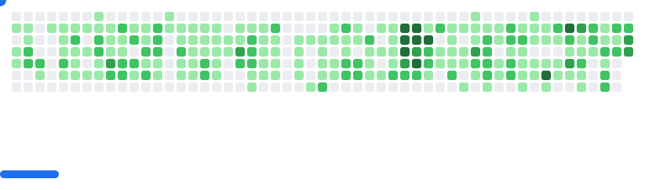

<!-- ════════════════════════════  BOOT  ════════════════════════════ -->
<div align="center">

```text
   ██╗  ██╗██╗   ██╗██╗   ██╗██████╗ ██╗███╗   ██╗███████╗
   ╚██╗██╔╝██║   ██║██║   ██║██╔══██╗██║████╗  ██║██╔════╝
    ╚███╔╝ ██║   ██║██║   ██║██████╔╝██║██╔██╗ ██║█████╗
    ██╔██╗ ██║   ██║██║   ██║██╔══██╗██║██║╚██╗██║██╔══╝
   ██╔╝ ██╗╚██████╔╝╚██████╔╝██████╔╝██║██║ ╚████║██║
   ╚═╝  ╚═╝ ╚═════╝  ╚═════╝ ╚═════╝ ╚═╝╚═╝  ╚═══╝╚═╝

 ┌──────────────────────────────────────────────────────────┐
 │ PLAYER: Binh      CLASS: Backend Mage   SUB: AI Summoner │
 │ HP ██████████     MP ████████░░         STATUS: ● ONLINE │
 └──────────────────────────────────────────────────────────┘
```

<a href="https://git.io/typing-svg">
  
</a>

</div>

<!-- ════════════════════════════  WHOAMI  ════════════════════════════ -->

## `> whoami`

```ts
// xuubinf@dev:~$ cat profile.ts
const binh = {
  alias:    "xuubinf",
  role:     ["Backend Engineer", "AI Engineer"],
  backend:  ["C# / .NET", "NestJS", "FastAPI", "Microservices + Kafka", "WebSocket"],
  ai:       ["LLM Apps", "RAG", "AI Agents", "MCP", "Computer Vision", "OCR"],
  storage:  ["MongoDB", "PostgreSQL", "Redis", "S3 / SeaweedFS", "Vector DB"],
  frontend: ["React", "Next.js", "Tailwind", "shadcn/ui", "Zustand"],
  client:   ["Avalonia (cross-platform desktop)", "Flutter (beginner 🐣)"],
  infra:    ["Docker", "K8s", "CI/CD"],
  motto:    "Unserious person, serious codebase.",
};
```


Hey there! 👋 I'm **Binh**, aka **xuubinf** on the internet. I build the backend so the app doesn't go 💥 when more than two people log in at the same time, and I plug AI brains into systems so they *think* instead of just *crash*.

These days I'm deep into **event-driven microservices**, **RAG & AI agents**, and **computer vision in production**: fine-tuning CV models and running face / license-plate / crowd detection on real camera streams. 📹

<br clear="right"/>

<!-- ════════════════════════════  CHARACTER SHEET  ════════════════════════════ -->

## 🎮 Character Sheet

<div align="center">

| 🧬 Skill Tree | ⚡ Power | 📝 Loadout |
|:--|:--|:--|
| ⚙️ **Backend Engineering** | `██████████` | Clean Architecture, REST, **WebSocket / Socket.IO**, **microservices with Kafka**, BullMQ job queues, Prisma / TypeORM, system design |
| 🧠 **LLM Apps & Agents** | `█████████░` | LangChain, LangGraph, tool calling, multi-agent, **MCP servers**, LLM observability with Langfuse |
| 📚 **RAG & Vector DB** | `████████░░` | Embedding, chunking, hybrid search, rerank, Qdrant / Milvus |
| 👁️ **Computer Vision** | `████████░░` | Fine-tuning, face recognition (InsightFace), ANPR (license plate), crowd/behavior detection, OCR (PaddleOCR / Docling) |
| 🗄️ **Data & Storage** | `████████░░` | MongoDB, PostgreSQL, Redis, **S3 / SeaweedFS** object storage |
| ☁️ **Cloud & DevOps** | `███████░░░` | Docker, Kubernetes, GitHub Actions, observability |
| 🎨 **Frontend** | `███████░░░` | **React**, **Next.js**, Vite, Tailwind, shadcn/ui, Zustand, TanStack Query: dashboards & admin portals |
| 🖥️ **Cross-platform Desktop** | `██████░░░░` | **Avalonia UI** (C#, MVVM): one codebase for Windows / macOS / Linux. Live video with LibVLCSharp + FFmpeg, maps with Mapsui, auto-update with Velopack |
| 📱 **Mobile** | `███░░░░░░░` | **Flutter**: still a beginner, still leveling up 🐣 |
| ☕ **Caffeine Tolerance** | `██████████` | MAX LEVEL (passive skill) |

</div>

<!-- ════════════════════════════  TECH STACK  ════════════════════════════ -->

## 🛠️ `> ls ~/arsenal`

<div align="center">

**⚙️ Backend**<br/>
<br/>


**🧠 AI / LLM**<br/>


**👁️ Computer Vision**<br/>
<br/>


**🗄️ Data & Storage**<br/>
<br/>


**🖥️ Frontend & Client**<br/>
<br/>


<br/>


**☁️ Cloud & DevOps**<br/>


</div>

<!-- ════════════════════════════  PROJECTS  ════════════════════════════ -->

## 🚀 `> ./featured-projects --sort=coolness`

<div align="center">

| 🗂️ Project | 📖 What it does | 🧪 Stack |
|:--|:--|:--|
| 📹 **Camera AI / VMS Platform** <br/><sub>🔒 private · team project</sub> | Video management system with AI: **ANPR**, **face recognition**, **behavior detection** (crowds, littering...) on live camera streams. Event-driven backend talking to the AI service over **Kafka**, plus a cross-platform desktop client for the monitoring center | `NestJS` `MongoDB` `Kafka` `PyTorch` `TensorRT` `Avalonia` `Flutter` |
| 🧠 **AI Agent Core** <br/><sub>🔒 private · team project</sub> | Production AI agent platform: LangGraph reasoning, multi-LLM provider management, document processing, RAG and a model evaluation framework | `FastAPI` `LangGraph` `MongoDB` `Milvus` `NestJS` |
| 💳 **Finance AI Backend** <br/><sub>🔒 private · team project</sub> | AI services for a finance app: **face verification**, **OCR**, document checking, loan scoring | `FastAPI` `MongoDB` `Qdrant` `SeaweedFS` |
| 🌱 [**BFarmX**](https://github.com/bfarm-sep490) <br/><sub>🎓 capstone</sub> | Agricultural data management with **blockchain** (VeChain) traceability and IoT integration | `.NET` `EF Core` `Docker` `Jenkins` `VeChain` |
| 📚 [**StudySpace**](https://github.com/EXE-StudySpace) <br/><sub>🎓 team project</sub> | Platform to manage and book study spaces | `.NET` `Docker` `TypeScript` |

</div>

<!-- ════════════════════════════  QUEST LOG  ════════════════════════════ -->

## 📜 Quest Log

```diff
+ [DONE]    Ship backend APIs that survive 3AM traffic
+ [DONE]    Wire up event-driven microservices with Kafka
+ [DONE]    Take CV models (face / plate / crowd) from notebook to production
+ [DONE]    Build RAG pipelines + agents with tool calling
! [ACTIVE]  Multi-agent orchestration with LangGraph + MCP
! [ACTIVE]  Optimize real-time CV inference across many cameras
! [ACTIVE]  Level up Flutter from 🐣 to 🐔
- [LOCKED]  Make the LLM return valid JSON. Every. Single. Time. 😭
```

<!-- ════════════════════════════  STATS  ════════════════════════════ -->

## 📈 `> git log --stats`

<div align="center">
  
  <a href="https://git.io/streak-stats">
    
  </a>
  
</div>

<div align="center">
  
</div>

<br/>
<div align="center">
  <a href="https://next.ossinsight.io/widgets/official/compose-activity-trends?repo_id=41986369" target="_blank">
    <picture>
      <source media="(prefers-color-scheme: dark)" srcset="https://next.ossinsight.io/widgets/official/compose-activity-trends/thumbnail.png?repo_id=41986369&image_size=auto&color_scheme=dark" width="815" height="auto">
      
    </picture>
  </a>
</div>

<!-- ════════════════════════════  ARCADE  ════════════════════════════ -->

## 🕹️ Arcade Zone

<div align="center">

**🐍 A snake eating my contributions, daily**

<picture>
  <source media="(prefers-color-scheme: dark)" srcset="images/snake-dark.svg" />
  <source media="(prefers-color-scheme: light)" srcset="images/snake-light.svg" />
  
</picture>

<br/><br/>

**🧱 Breakout: still holding onto that high score?**

<picture>
  <source media="(prefers-color-scheme: dark)" srcset="images/breakout-dark.svg" />
  <source media="(prefers-color-scheme: light)" srcset="images/breakout-light.svg" />
  
</picture>

<sub>⚡ Re-rendered every day by GitHub Actions</sub>

</div>

<!-- ════════════════════════════  COLLAB  ════════════════════════════ -->

## 🤝 `> help --collab`

```yaml
backend:          Clean architecture, microservices, Kafka, WebSocket, job queues, system design
ai_apps:          LLM apps, RAG, AI agents, MCP servers. From prototype to production
computer_vision:  Fine-tuning, face / license plate / event detection, real-time pipelines
frontend:         React / Next.js dashboards & admin portals
desktop:          Cross-platform desktop apps with Avalonia: live video, maps, auto-update
infra:            Docker, K8s, CI/CD, S3-compatible storage. Systems that stay up and scale
```

Got a wild idea or a chaotic codebase? **Let's build something cool together!** ✨

<!-- ════════════════════════════  CONNECT  ════════════════════════════ -->

## 📫 `> ping xuubinf`

<div align="center">
  <a href="mailto:core.dev.xuubinf@gmail.com" target="_blank">
    
  </a>
  <a href="https://linkedin.com/in/thangbinhbeo" target="_blank">
    
  </a>
  <a href="https://facebook.com/thangbinhbeo" target="_blank">
    
  </a>
  <a href="https://www.instagram.com/thangbinhbeo.wqtwpe/" target="_blank">
    
  </a>

  <br/><br/>
  
</div>

<!-- ════════════════════════════  EXIT  ════════════════════════════ -->

```console
xuubinf@dev:~$ exit
[session closed] thanks for dropping by. GG WP 🎮
```
